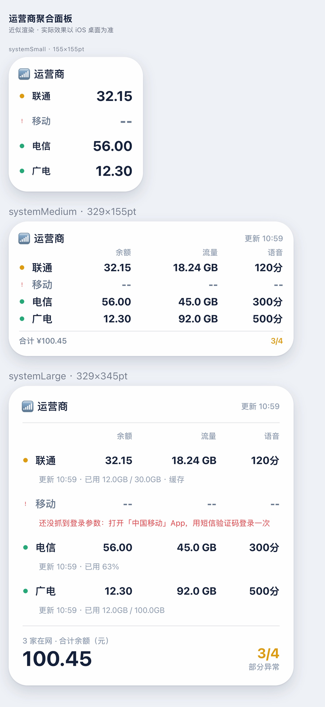

# 运营商聚合面板（Egern）

联通 / 移动 / 电信 / 广电，一个小组件全看完。



## 装

Egern → 工具 → 模块 → 右上角 `+` → 填这个 URL：

```
https://raw.githubusercontent.com/Konoha-Naruto/surge-vps-panel/main/carrier/carrier-hub.yaml
```

或者直接点：

<https://egernapp.com/modules/new?name=%E8%BF%90%E8%90%A5%E5%95%86%E8%81%9A%E5%90%88%E9%9D%A2%E6%9D%BF&url=https%3A%2F%2Fraw.githubusercontent.com%2FKonoha-Naruto%2Fsurge-vps-panel%2Fmain%2Fcarrier%2Fcarrier-hub.yaml>

装完去桌面加小组件，选 Egern → carrier-hub。中号和大号都能用。

## 选显示哪几家

模块设置里第一项 `显示哪几家`，逗号分隔，**顺序就是显示顺序**：

| 填法 | 结果 |
| --- | --- |
| `联通,移动,电信,广电` | 四家全上（默认） |
| `联通,电信` | 只显示这两家 |
| `移动` | 只显示移动，中号会空出三行位置 |
| `broadnet,unicom` | 也可以用英文键名 |

支持：`联通/cu/unicom`、`移动/cm/mobile`、`电信/ct/telecom`、`广电/cb/broadnet`。

另外三个开关控制大/中尺寸显示哪几列（余额 / 流量 / 语音）。2×2 小方块放不下三列，用 `小尺寸显示什么` 选一列（余额或流量）。

## 各家第一次怎么喂数据

四家的取数方式本来就不一样，合并版原样保留：

| 运营商 | 怎么初始化 |
| --- | --- |
| **联通** | 打开「中国联通」App 进一次余量页；或微信「中国联通」小程序进「余量查询」 |
| **移动** | 打开「中国移动」App，用**短信验证码**登录一次（别用面容/指纹），等通知 |
| **电信** | 不走抓包。模块设置里直接填手机号 + 服务密码；设备 ID 可选 |
| **广电** | 打开「中国广电」App 或微信/支付宝小程序查询一次 |

电信必须在设置里填账号，其它三家抓一次就行。

> **装之前先把原来那四个模块停用。** 抓包脚本会重复监听同一批 URL，虽然不出错，但白发一遍请求。电信原来配在旧模块里的账号密码，删之前抄一下，聚合模块里要重填。

## 状态点和数字

- 🟢 绿点：数据正常
- 🟡 黄点：用的是缓存（上游接口没刷新，24 小时内还能看）
- 🔴 红点 + `--`：没配好或登录过期，大号面板第二行会写具体原因
- 大号底部：在网家数 + 余额合计 + 正常家数

刷新节奏：面板脚本 15 分钟跑一次，四家各自的缓存（联通 45 秒 / 移动保活 20 分钟 / 电信 30 分钟 / 广电 15 分钟）会挡住大部分重复请求。iOS 本身对桌面小组件有节流，实际大概 15–30 分钟一次。

## 咋合的

没有重写任何一家的请求逻辑。构建时把四份官方脚本原文嵌进来，各做两处最小改动：

1. `export default async function(ctx)` → 赋给内部变量，包进 IIFE 隔离四家同名的 `KEY` / `C` / `t`
2. 在各自 `handleWidget` 拿到数据后加一行探针，把解析好的 `ds` 挂到 `globalThis.__CARR__.ds`

运行时并发调四家的 `default(ctx)`，数据探针收数，然后统一用一套表格渲染。所以：

- 上游改了接口 / 加解密 / 登录逻辑，重新构建就跟着走，不用改聚合层
- 四家的抓包（`http_request` / `http_response`）和保活（`schedule`）还是指向上游原脚本，storage 的 key 跟内联版完全一致，数据互通
- 任何一家抛错只影响自己那一行

## 重新构建

```bash
python3 build.py          # vendor/ 里四份上游脚本 → dist/carrier-hub.js
node test/harness.mjs systemLarge --offline   # 本地模拟 ctx 跑一遍
python3 render.py         # 生成 preview/preview.html 近似预览
```

`build.py` 对每家的探针锚点做了命中数校验（必须正好 1 次），上游改版会直接报错，不会静默失效。

## 上游

- 联通：<https://github.com/moyuzaime/egern/tree/main/ChinaUnicom>
- 广电：<https://github.com/moyuzaime/egern/tree/main/ChinaBroadnet>
- 移动：<https://github.com/zhaohantao1360-hash/Hark>
- 电信：<https://github.com/IBL3ND/module>
